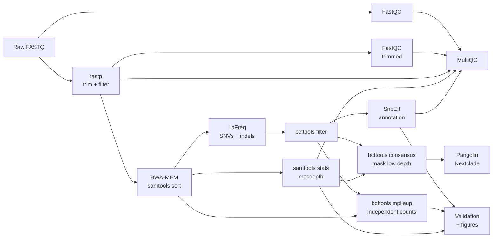

# SARS-CoV-2 Variant Calling Pipeline

An end-to-end, reproducible [Nextflow](https://www.nextflow.io/) pipeline that takes raw paired-end Illumina reads
to an annotated variant table, a consensus genome and a lineage assignment, and checks its own variant calls.
It runs on a laptop in about a minute.


## Summary

Two public SARS-CoV-2 clinical samples ([SRR10903401](https://www.ncbi.nlm.nih.gov/sra/SRR10903401) and
[SRR10903402](https://www.ncbi.nlm.nih.gov/sra/SRR10903402), early 2020) were analysed against the Wuhan-Hu-1
reference (NC_045512.2).

| | SRR10903401 | SRR10903402 |
|---|---|---|
| Read pairs (raw → after trimming) | 476,632 → 396,081 | 676,694 → 583,438 |
| Reads mapping to SARS-CoV-2 | 3.1% | 8.3% |
| Mean depth / genome ≥30x | 140x / 97.8% | 539x / 99.7% |
| Minor variants reported (AF ≥ 5%) | 13 (3 indels) | 5 |
| Variants at majority frequency (AF ≥ 50%) | 0 | 0 |
| Lineage (Pango / Nextstrain clade) | B / 19A | B / 19A |

**Main findings**

- Both consensus genomes are identical to Wuhan-Hu-1 (apart from low-coverage positions masked as `N`) and fall in the
  basal lineage B, consistent with samples from the very start of the outbreak.
- Most reads are not viral (host RNA), but the genome is small, so depth is still high enough for confident calling.
- One minor variant stands out: `24323 A>C` in the Spike gene (p.Lys921Gln) in SRR10903401, at 39% frequency, confirmed
  by an independent allele count with balanced strands. The other minor variants (5-10%) are weak evidence and are
  treated cautiously; see [Limitations](#limitations).


## Quick start

```bash
git clone https://github.com/BrunoFOmena/sars-cov2-variant-calling.git
cd sars-cov2-variant-calling

micromamba env create -f environment.yml      # about 10 GB on disk
micromamba activate sars2-vc

bash scripts/download_data.sh                 # ~80 MB, checksum-verified
nextflow run main.nf -profile local           # ~1 min on 12 threads
```

Results are written to `results/`. Use `-profile conda` instead of activating the environment first and Nextflow will
build it itself (tested from scratch: identical consensus, variants and lineage calls). The environment is large, so
keep the work directory off a small `/tmp` partition (`-w /path/with/space`).

## Pipeline



| Stage | Tool | Notes |
|---|---|---|
| Workflow | Nextflow (DSL2) | One module per stage in [`modules/`](modules/) |
| Raw and trimmed QC | FastQC, MultiQC | Reports before and after trimming |
| Trimming | fastp | Paired-end, adapter auto-detection, quality and length filters |
| Alignment | BWA-MEM, samtools | Duplicates are not removed: positional duplicates are expected at this depth on a 30 kb genome |
| Coverage | mosdepth, samtools stats | Per-base depth feeds the consensus mask and the figures |
| Variant calling | LoFreq | Calls SNVs and indels with allele frequencies, suited to viral populations with minor variants |
| Filtering | bcftools | QUAL ≥ 30, depth ≥ 10, allele frequency ≥ 0.05 |
| Annotation | SnpEff | Gene and amino-acid effects on NC_045512.2 |
| Consensus | bcftools consensus | Only variants with AF ≥ 0.5 applied; positions below 10x masked as `N` |
| Lineage | Pangolin, Nextclade | Tool and dataset versions are recorded in the results |
| Validation | bcftools mpileup, Python | Independent allele counts per strand, Fisher test for strand bias |

All thresholds are parameters in [`nextflow.config`](nextflow.config).

## Data and provenance

| Item | Source | Details |
|---|---|---|
| Reads | SRA [SRR10903401](https://www.ncbi.nlm.nih.gov/sra/SRR10903401), [SRR10903402](https://www.ncbi.nlm.nih.gov/sra/SRR10903402) | Illumina MiSeq, paired-end, RNA-Seq of human clinical samples |
| Reference | [NC_045512.2](https://www.ncbi.nlm.nih.gov/nuccore/NC_045512.2) | Wuhan-Hu-1, 29,903 bp, FASTA and GFF3 |

The reads come from [doi:10.1093/nsr/nwaa036](https://doi.org/10.1093/nsr/nwaa036) and are also the example dataset of
the [V-pipe](https://cbg-ethz.github.io/V-pipe/) tutorial.

`scripts/download_data.sh` fetches everything and writes [`data/MANIFEST.tsv`](data/MANIFEST.tsv) with source URL, size,
checksum and retrieval date of each file. Reads are verified against the md5 reported by ENA; the reference is recorded
with a sha256 (NCBI does not provide one). The FASTQ files are not committed, but the manifest is, so any download can
be checked against what was analysed.

## Results

### Dataset check

Raw-read QC ([MultiQC report](docs/qc/multiqc_raw.html)) and a quick mapping
([table](docs/qc/mapping_summary.tsv), produced by `scripts/qc_raw_and_mapping_check.sh`) were used to decide whether the
dataset was suitable before building the pipeline.

- Only 3-8% of reads map to SARS-CoV-2, as expected from metatranscriptomic data, yet both samples cover essentially
  the whole genome at ≥30x. An amplicon-sequencing dataset (ARTIC) was considered as an alternative and was not needed.
- FastQC flags adapter content and duplication in all files, which motivates the trimming step. Per-base quality passes.

### Variants

Annotated tables are in [`docs/results/`](docs/results/) (`*.variants.tsv`), merged with the validation columns in
[`variants_validated.tsv`](docs/results/variants_validated.tsv). The comparison of the two samples is in
[`sample_comparison.tsv`](docs/results/sample_comparison.tsv): only `1821 G>A` is shared.

### Validation of the calls

Each LoFreq SNV is re-counted from the alignment with `bcftools mpileup` (no BAQ, MAPQ ≥ 20, base quality ≥ 20) with
per-strand counts.

| Verdict | SRR10903401 | SRR10903402 |
|---|---|---|
| Supported (≥3 alt reads, no strand bias) | 7 | 5 |
| Unsupported (<3 alt reads in the independent count) | 3 | 0 |
| Indels (not assessed by this method) | 3 | 0 |
| Strand bias | 0 | 0 |


The two methods agree closely on allele frequency. Coverage is uneven, drops at a few positions (masked as `N`) and
rises sharply at the 3' end, which is expected in coronavirus RNA-seq because of subgenomic RNAs.

### Lineage

Pangolin 4.4 (data v1.41) and Nextclade 3.29.1 (dataset 2026-10-28) assign both samples to **Pango B / Nextstrain 19A**
with zero substitutions against Wuhan-Hu-1 ([`docs/results/lineage/`](docs/results/lineage/)). This is weakly
informative: lineage B is defined by the absence of later lineage-defining mutations, so the result mostly confirms
that the consensus equals the reference.

## Limitations

- **Low-frequency calls are weak evidence.** Most minor variants sit at 5-10% frequency, a range where reverse
  transcription errors and sequencing artifacts also appear in RNA-seq data. They should not be read as real
  intra-host variation. `1821 G>A` appears in both samples, but both come from the same study, so the overlap could
  be systematic.
- **The validation re-reads the same alignment.** It checks the caller, the filters and strand balance, not artifacts
  introduced earlier (reverse transcription, library preparation). Only a replicate or an independent library would.
- **Indels are not validated.** The two frameshifts and the stop-gain, all at low frequency, are the least trustworthy
  calls.
- **No biological replicates**, and only two samples, so no population-level conclusions can be drawn.
- **Host contamination** is high; the pipeline does not filter host reads, which is harmless here but would matter for
  lower-depth samples.

## Compute

Measured on a laptop (Intel i5-12450HX, 12 threads, 7.6 GB RAM, WSL2):

| | |
|---|---|
| Clean run, both samples | ~53 s, 22 processes |
| Peak memory of any process | ~1.3 GB |
| Disk | ~170 MB for data and results, ~10 GB for the conda environment |
| GPU | not used |

## Repository layout

```
.
├── main.nf                  # workflow definition
├── nextflow.config          # parameters (thresholds, paths) and profiles
├── modules/                 # one Nextflow module per stage
├── bin/validate_and_plot.py # validation, sample comparison and figures
├── scripts/
│   ├── download_data.sh               # data download with checksums
│   └── qc_raw_and_mapping_check.sh    # exploratory dataset check
├── environment.yml          # tools (conda)
├── environment.lock.yml     # exact resolved versions
├── data/
│   ├── MANIFEST.tsv         # provenance of every downloaded file
│   └── reference/           # NC_045512.2 FASTA + GFF3
├── docs/
│   ├── qc/                  # raw-read QC and mapping check
│   └── results/             # variant tables, consensus FASTAs, figures, lineage, MultiQC, run trace
└── LICENSE
```

`data/raw/`, `results/`, `work/` and Nextflow caches are git-ignored and recreated by the pipeline.

## Possible extensions

- Validate indels with a second caller or with the read-level alignment.
- Add an amplicon-based dataset (ARTIC) with primer trimming.
- Run on more samples to compare variant patterns across a cohort.

## References

- Dataset publication: [doi:10.1093/nsr/nwaa036](https://doi.org/10.1093/nsr/nwaa036)
- Reference genome: [NC_045512.2](https://www.ncbi.nlm.nih.gov/nuccore/NC_045512.2)
- V-pipe tutorial dataset: <https://cbg-ethz.github.io/V-pipe/tutorial/sars-cov2/>

## License

Released under the [MIT License](LICENSE).
