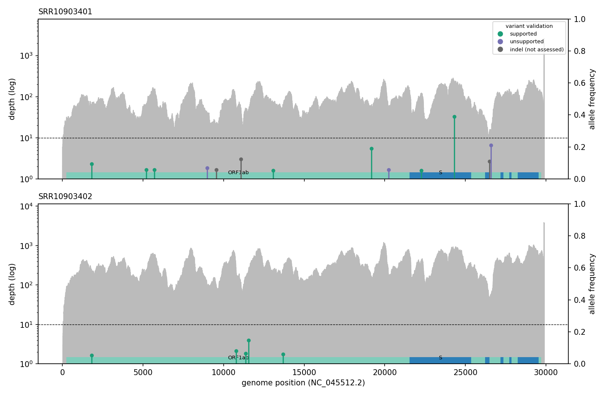
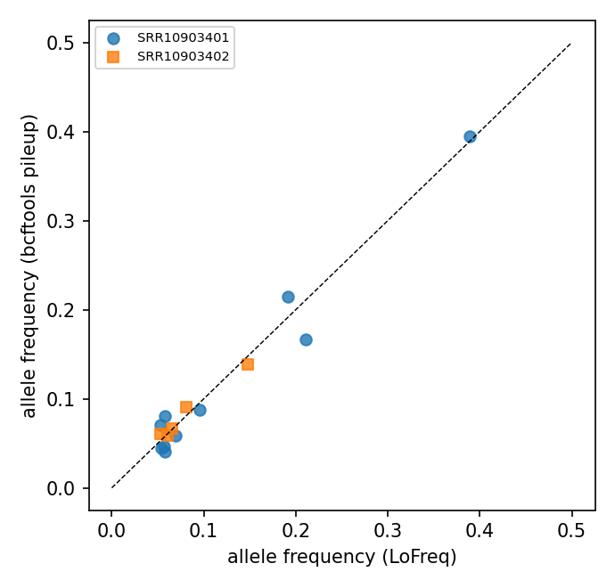

# SARS-CoV-2 Variant Calling Pipeline

A reproducible, laptop-friendly pipeline that goes from raw paired-end Illumina reads to an annotated list of
SARS-CoV-2 variants, a consensus genome and a lineage assignment.

> **Status:** planning phase. This README documents the strategy; results and figures will be added as each
> stage is implemented.

## Goals

1. Build an end-to-end variant calling workflow with standard, widely used bioinformatics tools.
2. Keep it fully reproducible (pinned environment, workflow manager, scripted downloads).
3. Run on a consumer laptop in minutes, not hours.
4. Produce portfolio-ready outputs: QC reports, coverage plots, an annotated variant table and a consensus genome.

## Data

| Item | Accession | Details |
|---|---|---|
| Sample 1 | [SRR10903401](https://www.ncbi.nlm.nih.gov/sra/SRR10903401) | Illumina MiSeq, paired-end, 476,632 read pairs, ~144 Mbp, ~31 MB FASTQ.gz |
| Sample 2 | [SRR10903402](https://www.ncbi.nlm.nih.gov/sra/SRR10903402) | Illumina MiSeq, paired-end, 676,694 read pairs, ~204 Mbp, ~47 MB FASTQ.gz |
| Reference | [NC_045512.2](https://www.ncbi.nlm.nih.gov/nuccore/NC_045512.2) | Wuhan-Hu-1, complete genome, 29,903 bp (accession verified against NCBI) |

The reads come from the study published in *National Science Review* ([doi:10.1093/nsr/nwaa036](https://doi.org/10.1093/nsr/nwaa036))
and are also the example dataset of the [V-pipe](https://cbg-ethz.github.io/V-pipe/) tutorial.

**Caveat:** the library strategy is RNA-Seq (metatranscriptomics) from a human clinical sample, so a large share
of reads may be human/host. The mapping rate and the depth across the genome are therefore a QC result to be
reported, not an assumption. Any region with low coverage will be masked in the consensus.

### Data provenance

`bash scripts/download_data.sh` fetches everything and writes `data/MANIFEST.tsv`. Reads come from the ENA mirror of
the SRA and are verified against the md5 reported by ENA; the reference FASTA and GFF3 come from NCBI E-utilities and
are recorded with a sha256. The raw FASTQ files are not committed (git-ignored), but the manifest is, so any
download can be checked against exactly what was used in the analysis.

## Preliminary results: dataset check

Raw-read QC (FastQC + MultiQC, report in [`docs/qc/multiqc_raw.html`](docs/qc/multiqc_raw.html)) and a quick BWA mapping
against NC_045512.2 ([`docs/qc/mapping_summary.tsv`](docs/qc/mapping_summary.tsv)):

| Sample | Reads | Mapped to SARS-CoV-2 | Mean depth | Genome >=10x | Genome >=30x |
|---|---|---|---|---|---|
| SRR10903401 | 953,264 | 3.1% | 139.8x | 99.9% | 97.8% |
| SRR10903402 | 1,353,388 | 8.3% | 539.2x | 99.9% | 99.7% |

- As suspected, most reads are not viral (host and other RNA), only 3-8% map to the virus.
- Even so, absolute depth is high because the genome is tiny: both samples cover essentially the whole genome at
  >=30x, which is enough for confident variant calling. **The original dataset is kept; the ARTIC alternative is not
  needed.**
- FastQC flags adapter content and duplication levels in all files, which supports the trimming step. Per-base quality passes.
- Duplicates are not removed (see the strategy section): at this depth on a 30 kb genome, positional duplicates are
  expected.

## Pipeline results

Implemented in Nextflow (DSL2): [`main.nf`](main.nf), [`nextflow.config`](nextflow.config) and one module per stage in
[`modules/`](modules/). A clean run (no cache) of the 22 processes for both samples takes **~53 s** on the laptop.

```bash
micromamba activate sars2-vc
bash scripts/download_data.sh
nextflow run main.nf -profile local     # or -profile conda to let Nextflow build the environment
```

Thresholds (all in `nextflow.config`): variants kept if QUAL >= 30, depth >= 10 and allele frequency >= 0.05; only
variants with AF >= 0.5 are applied to the consensus; positions below 10x are masked as `N`.

| | SRR10903401 | SRR10903402 |
|---|---|---|
| Read pairs after fastp (before) | 396,081 (476,632) | 583,438 (676,694) |
| Reads with adapters trimmed | 208,927 | 295,145 |
| Variants reported (AF >= 0.05) | 13 (3 indels) | 5 (0 indels) |
| Variants with AF >= 0.5 | 0 | 0 |
| Consensus | 29,903 bp, 42 N | 29,903 bp, 39 N |

Outputs in [`docs/results/`](docs/results/): annotated variant tables (`*.variants.tsv`), consensus FASTAs, the MultiQC
report and the Nextflow trace.

### Interpretation (and what it does not show)

- **Both consensus genomes are identical to Wuhan-Hu-1** apart from masked positions: no variant reached 50% allele
  frequency. This fits samples from the very beginning of the outbreak, but lineage assignment is still pending, so
  this is an expectation to confirm and not a result yet.
- **All reported variants are minor (sub-clonal) variants**, mostly at 5-10% frequency. In RNA-seq data from clinical
  samples, reverse-transcription errors and sequencing artifacts also produce calls in this range, so these should not
  be read as real intra-host variation without further evidence. The shared call `1821 G>A` (p.Gly519Asp) appearing in
  both samples at low frequency is one example worth checking.
- **One candidate worth following up:** `24323 A>C` in the spike gene (p.Lys921Gln) in SRR10903401, 38.9% allele
  frequency at 319x depth with a very high quality score. That is much stronger evidence than the 5% calls, although
  it still needs a second caller and a look at the alignment before it is trusted.
- The high-impact calls (a stop-gain at AF 0.057 and two frameshifts at AF 0.057 and 0.125) are exactly the kind of
  low-frequency indel/stop events most likely to be artifacts.

### Validation of the variant calls

Each LoFreq SNV is re-counted from the alignment with `bcftools mpileup` (different filters: no BAQ, MAPQ >= 20,
base quality >= 20), with per-strand counts and a Fisher test for strand imbalance
([`docs/results/variants_validated.tsv`](docs/results/variants_validated.tsv)).

| Verdict | SRR10903401 | SRR10903402 |
|---|---|---|
| Supported (>= 3 alt reads, no strand bias) | 7 | 5 |
| Unsupported (< 3 alt reads in the independent count) | 3 | 0 |
| Indels (not assessed by this method) | 3 | 0 |
| Strand bias | 0 | 0 |





- Allele frequencies from the two methods agree closely (second figure), and `24323 A>C` (Spike p.Lys921Gln) holds up
  with a balanced strand distribution (40 forward / 46 reverse alt reads).
- Coverage is uneven but above 10x everywhere except a few positions (masked as `N`). It rises sharply at the 3' end,
  which is expected in coronavirus RNA-seq because of subgenomic RNAs.
- **Limit of this check:** it re-reads the same alignment, so it validates the caller, the filters and strand balance,
  but not artifacts introduced earlier (reverse transcription, library preparation). Only an independent library or
  replicate would address that. The comparison between samples ([`sample_comparison.tsv`](docs/results/sample_comparison.tsv))
  shares only `1821 G>A`, and both samples come from the same study, so that overlap could also be systematic.
- Indel calls, including the frameshifts, were not validated here and remain the least trustworthy results.

## Compute budget

Measured on the development machine (WSL2 on Windows):

| Resource | Available | Needed by this project |
|---|---|---|
| CPU | Intel i5-12450HX, 12 threads | 4-8 threads is plenty |
| RAM | 7.6 GB (+2 GB swap) | < 2 GB (a 30 kb genome index is tiny) |
| Disk | ~940 GB free in WSL | < 1 GB including raw data and intermediates |
| GPU | RTX 3050 6 GB | Not used (no step benefits from it) |
| Network | OK | ~80 MB of downloads |

**Conclusion:** the whole dataset fits comfortably on this laptop. No cloud or HPC resources are required, and
the full pipeline should finish in a few minutes. Since compute is not a constraint, the effort goes into
analysis quality (QC, filtering, annotation, interpretation) rather than into scaling.

## Strategy

```
SRA (ENA mirror) ──► raw FASTQ (R1/R2)
                         │
                         ▼
              FastQC / MultiQC (raw)
                         │
                         ▼
          fastp: paired-end trimming + filtering
                         │
                         ▼
              FastQC / MultiQC (trimmed)
                         │
                         ▼
        BWA-MEM2 (or bwa mem) ──► samtools sort/index
                         │
                         ▼
     samtools stats / flagstat / depth, mosdepth
                         │
                         ▼
        LoFreq variant calling (low-frequency aware)
                         │
                         ▼
    bcftools filter ──► SnpEff annotation (NC_045512.2)
                         │
                    ┌────┴─────┐
                    ▼          ▼
        bcftools consensus   Pangolin / Nextclade
        (mask depth < 10x)   (lineage / clade)
                         │
                         ▼
        Summary tables + plots (Python / R)
```

### Stages

1. **Data retrieval.** Download FASTQ from the ENA mirror of the SRA accessions (plain HTTPS, no `sra-tools`
   needed) and the reference FASTA/GFF from NCBI. Checksums are recorded.
2. **Raw QC.** FastQC per file, aggregated with MultiQC.
3. **Trimming and filtering.** `fastp` in paired-end mode: adapter auto-detection, quality trimming, length
   filter, pair-aware. Its JSON/HTML report is kept.
4. **Alignment.** Map to NC_045512.2, sort and index. Duplicates are *not* blindly removed, since amplicon-like or
   very high coverage in a tiny genome makes position-based duplicate removal misleading; this decision will be
   justified in the report.
5. **Alignment QC.** Mapping rate, mean depth, % genome at >=10x/>=30x, depth profile along the genome.
6. **Variant calling.** `LoFreq` for SNVs and indels with allele frequencies (suited to viral populations where
   minor variants matter). Optionally cross-checked with `bcftools mpileup | call` as an independent caller to
   report concordance.
7. **Filtering and annotation.** Filter on depth, quality and allele frequency; annotate effects on genes with
   SnpEff using the Wuhan-Hu-1 annotation (e.g. S, ORF1ab, N).
8. **Consensus and lineage.** Build a consensus genome with low-coverage positions masked as `N`, then assign
   lineage/clade with Pangolin and Nextclade.
9. **Reporting.** Per-sample variant tables, allele frequency distribution, genome-wide coverage plot and a final
   summary table.

### Tools

| Purpose | Tool |
|---|---|
| Workflow manager | Nextflow (DSL2) |
| Environment | Conda (via micromamba, already installed) with bioconda/conda-forge, pinned in `environment.yml` |
| QC | FastQC, MultiQC, fastp |
| Alignment | BWA-MEM2 / BWA, samtools, mosdepth |
| Variants | LoFreq, bcftools |
| Annotation | SnpEff |
| Lineage | Pangolin, Nextclade |
| Plots | Python (matplotlib/pandas) |

### Planned repository layout

```
.
├── README.md
├── environment.yml        # pinned conda environment
├── main.nf                # Nextflow workflow definition
├── nextflow.config        # accessions, paths, thresholds, profiles
├── modules/               # one process module per tool
├── bin/                   # plotting and summary helper scripts
├── scripts/               # setup helpers (data download)
├── data/
│   ├── raw/               # raw FASTQ files (git-ignored, restored by the download script)
│   ├── reference/         # NC_045512.2 FASTA + GFF3 (tracked)
│   └── MANIFEST.tsv       # source URL, size, checksum and date of every file (tracked)
├── results/               # pipeline outputs (large files git-ignored)
└── docs/                  # figures and report used in the README
```

## Expected deliverables (for the portfolio)

- MultiQC report before and after trimming.
- Genome coverage/depth plot for each sample.
- Annotated VCF and a readable variant table (position, ref/alt, gene, amino-acid change, allele frequency).
- Consensus FASTA and lineage/clade call.
- Comparison of the two samples (shared vs. private variants).
- A short interpretation section, including limitations (host contamination, low-frequency variant calls,
  no biological replicates).

## Roadmap

- [x] Assess hardware and dataset size
- [x] Verify accessions (SRR10903401, SRR10903402, NC_045512.2)
- [x] Set up the conda environment
- [x] Data download script (`scripts/download_data.sh`)
- [x] Raw QC and exploratory mapping check (`scripts/qc_raw_and_mapping_check.sh`)
- [x] Nextflow pipeline: fastp trimming, BWA alignment, alignment QC, LoFreq calling, SnpEff annotation, consensus, MultiQC
- [ ] Lineage assignment (Pangolin / Nextclade)
- [x] Independent allele counting (bcftools mpileup) with strand-bias check
- [x] Figures (coverage profile, allele-frequency concordance) and sample comparison

## Reproducibility

Once implemented, the whole analysis will be run with:

```bash
micromamba env create -f environment.yml
micromamba activate sars2-vc
nextflow run main.nf -profile conda
```

## References

- Dataset publication: [doi:10.1093/nsr/nwaa036](https://doi.org/10.1093/nsr/nwaa036)
- Reference genome: [NC_045512.2](https://www.ncbi.nlm.nih.gov/nuccore/NC_045512.2)
- V-pipe tutorial dataset: <https://cbg-ethz.github.io/V-pipe/tutorial/sars-cov2/>
